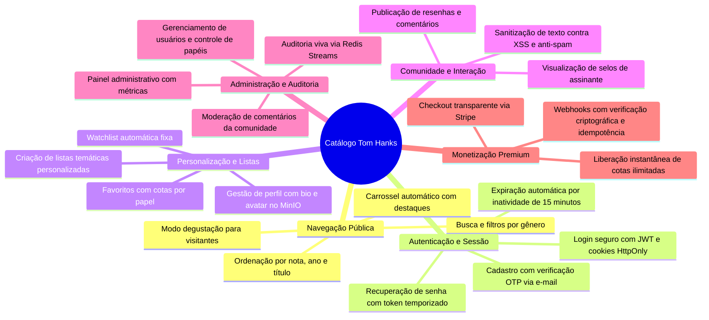
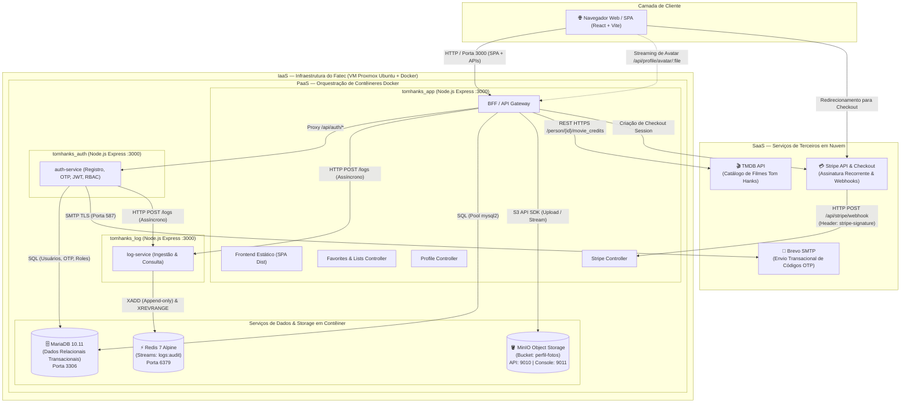
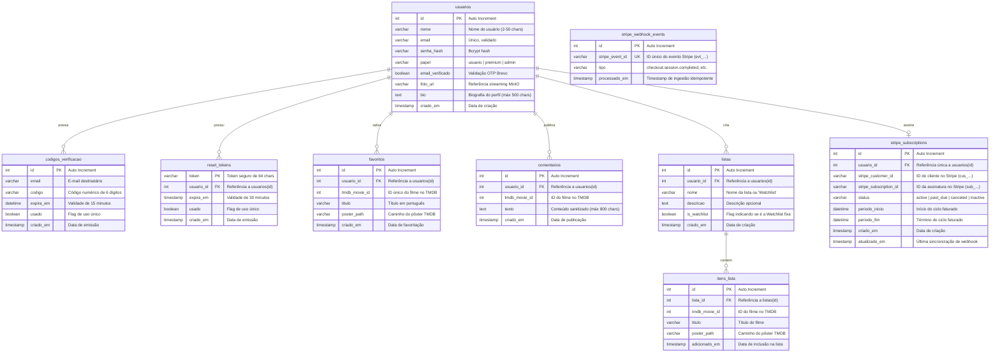

# 📚 Documentação Reversa do Sistema — Catálogo de Filmes Tom Hanks

> **Disciplina:** Introdução à Computação em Nuvem (ISW055) — **Fatec Pompeia**  
> **Professor:** [@siriani](https://github.com/siriani)  
> **Desenvolvedor:** Daniel Marçal Gonçalves  
> **Contexto:** Encerramento da série de atividades (*agenda → catálogo → login → RBAC → logs → perfil → premium*). Esta documentação foi elaborada sob a perspectiva de um engenheiro de software que herda um sistema legado em produção e realiza a engenharia reversa completa de sua arquitetura, regras de negócio e modelo de dados sem alterar linhas de código.

---

## 📑 Sumário

1. [Especificação Funcional (Visão do Usuário e Operador)](#1-especificação-funcional)
2. [Arquitetura Geral do Sistema (Big Picture)](#2-arquitetura-geral-do-sistema)
3. [Regras de Negócio Extraídas do Código ("Se X, então Y")](#3-regras-de-negócio-do-sistema)
4. [Modelo de Dados e Diagrama Entidade-Relacionamento](#4-modelo-de-dados)
5. [Mapeamento de Serviços e Endpoints da API](#5-mapeamento-de-serviços-e-endpoints)

---

## 1. Especificação Funcional

O sistema é uma plataforma interativa de catálogo cinematográfico focada na filmografia do ator Tom Hanks, combinando navegação pública, personalização de usuário, segurança corporativa, auditoria em tempo real e modelo de monetização via assinatura.

### 1.1 Módulos Funcionais do Sistema

### 1.2 Experiência por Perfil de Usuário

#### A. Visitante Não Autenticado (Modo Degustação)
- Acessa a página inicial, visualiza o banner em carrossel rotativo (intervalo de 5 segundos) e navega por toda a filmografia obtida via integração com a API externa TMDB.
- Pode filtrar filmes por gêneros (*Drama, Comédia, Guerra, Animação, Aventura, Romance*), pesquisar por título e ordenar por relevância, ano de lançamento ou nota média.
- Consegue abrir os detalhes de qualquer filme e ler os comentários deixados pela comunidade.
- Ao tentar favoritar, adicionar à Watchlist ou postar um comentário, o sistema intercepta a ação e exibe o modal amigável de **Ação de Visitante**, convidando-o a realizar login ou criar uma conta gratuita.

#### B. Usuário Cadastrado Comum (`papel = 'usuario'`)
- Cria sua conta informando nome, e-mail válido e senha (mínimo 6 caracteres). Recebe um código numérico OTP (One-Time Password) de 6 dígitos no e-mail transacional (enviado via Brevo SMTP). A conta permanece bloqueada para login até a confirmação do código.
- Após logado, pode favoritar até **5 filmes** (cota gratuita). Se tentar favoritar o 6º filme, o sistema bloqueia preventivamente e exibe o modal convidando para o upgrade Premium.
- Possui uma **Watchlist** pessoal fixa para salvar até 10 filmes que pretende assistir.
- Pode criar até **2 listas personalizadas** adicionais para organizar filmes por tópicos próprios.
- Pode comentar em qualquer filme (até 800 caracteres, sem links ou scripts). O usuário pode excluir apenas seus próprios comentários.
- Acessa a página **Meu Perfil** para alterar seu nome de exibição, redigir uma biografia (até 500 caracteres) e fazer upload de foto de avatar (até 5 MB em JPEG/PNG/WebP), que é enviada ao MinIO Object Storage.
- Caso fique **15 minutos inativo** sem mover o mouse ou interagir, o frontend descarta a sessão, aciona o backend para auditoria e exibe aviso de sessão expirada.

#### C. Assinante Premium (`papel = 'premium'`)
- Obtém o status assinando o plano mensal de R$ 9,90/mês através do **Stripe Checkout**.
- Exibe o selo **👑 Premium** dourado em seu avatar, cabeçalho e nos comentários postados.
- **Favoritos Ilimitados:** a barreira dos 5 filmes é removida pelo backend e frontend.
- **Watchlist Ilimitada:** cota expandida para até 9.999 títulos.
- **Listas Personalizadas:** cota expandida para criação de até 10 listas customizadas.
- Histórico e status de renovação da assinatura gerenciáveis pela aba Premium.

#### D. Administrador (`papel = 'admin'`)
- Acesso restrito ao **Painel Administrativo** (`AdminDashboard`), protegido no frontend e com bloqueio estrito `HTTP 403 Forbidden` no backend.
- **Aba Usuários:** visualiza todos os usuários registrados, pode promover ou rebaixar papéis (*usuario, premium, admin*) e excluir contas.
- **Aba Moderação de Comentários:** visualiza resenhas de todos os usuários e pode deletar comentários inadequados de terceiros, com registro auditado.
- **Aba Auditoria (Redis Streams):** visualizador em tempo real dos eventos trafegados na chave `logs:audit` do Redis, com filtros categorizados (*Bloqueios 403, Logins, Favoritos, Comentários, Moderação*) e visualização do payload JSON original.

---

## 2. Arquitetura Geral do Sistema

O sistema foi concebido como uma arquitetura de microsserviços conteinerizada, desacoplando tarefas de frontend/gateway, autenticação com envio de e-mails, auditoria de eventos em alta performance, armazenamento de objetos binários e banco relacional.

### 2.1 Diagrama de Arquitetura Completo (Mermaid)

### 2.2 Papéis e Comunicações dos Contêineres

| Contêiner | Papel no Sistema | Portas (Host : Container) | Protocolos & Conexões Ativas |
| :--- | :--- | :---: | :--- |
| **`tomhanks_app`** | Host do frontend compilado, Gateway de rotas de negócio (filmes, listas, favoritos, perfil, pagamentos Stripe) | `3000:3000` | HTTP com cliente; HTTP interno com `auth-service` e `log-service`; TCP com `mariadb`; S3 API com `minio`; HTTPS com `TMDB` e `Stripe`. |
| **`tomhanks_auth`** | Microsserviço isolado para ciclo de vida de contas, geração de hash bcrypt, emissão e validação de tokens JWT, OTP de e-mail e RBAC. | *Privada* | TCP com `mariadb`; SMTP TLS com `Brevo`; HTTP interno com `log-service`. |
| **`tomhanks_log`** | Microsserviço de auditoria desacoplado de escrita de alta vazão, ingerindo eventos via `XADD` e servindo consultas via `XREVRANGE`. | *Privada* | TCP com `redis` (porta 6379 interna). |
| **`tomhanks_redis`** | Servidor de cache e streams em memória com persistência AOF (*Append-Only File*). | *Privada* | Armazena o stream append-only `logs:audit`. |
| **`tomhanks_minio`** | Object Storage compatível com AWS S3 para armazenamento durável e seguro de fotos de perfil sem onerar o banco relacional. | `9010:9000` `9011:9001` | Comunica via protocolo S3 com a biblioteca oficial `minio-js` no backend. |
| **`tomhanks_mariadb`** | Banco de dados relacional principal que garante consistência transacional e integridade referencial para dados cadastrais e de catálogo. | `127.0.0.1:3307:3306` | InnoDB com foreign keys, índices de busca e collation utf8mb4. |

---

## 3. Regras de Negócio do Sistema

Abaixo estão listadas todas as regras de negócio identificadas e extraídas diretamente da análise do código-fonte, estruturadas sob a forma estrita de **"Se [Condição], então [Ação/Comportamento]"**.

### 3.1 Autenticação, Cadastro e Sessão

| # | Regra ("Se X, então Y") | Arquivo de Origem no Código |
| :-: | :--- | :--- |
| **RN-01** | **Se** o usuário enviar um nome no cadastro com menos de 2 caracteres, mais de 50 caracteres, caracteres especiais não alfanuméricos ou palavras restritas (`admin`, `root`, etc.), **então** o sistema rejeita a requisição com `HTTP 400 Bad Request`. | `backend/src/middlewares/security.js` |
| **RN-02** | **Se** um mesmo IP tentar se cadastrar mais de 5 vezes dentro de uma janela de 15 minutos, **então** o backend bloqueia com `HTTP 429 Too Many Requests`. | `backend/src/middlewares/security.js` |
| **RN-03** | **Se** um novo usuário for inserido no banco, **então** seu status inicial é gravado como `email_verificado = FALSE`, um código OTP aleatório de 6 dígitos é gerado com validade de 15 minutos na tabela `codigos_verificacao` e disparado via e-mail. | `auth-service/server.js` |
| **RN-04** | **Se** o usuário tentar efetuar login e sua conta possuir `email_verificado = FALSE`, **então** o sistema recusa a autenticação com `HTTP 403 Forbidden` (`requireVerification: true`), impedindo a emissão de token JWT. | `backend/src/middlewares/auth.js` |
| **RN-05** | **Se** um IP errar a verificação de código OTP mais de 5 vezes consecutivas para um mesmo e-mail, **então** o sistema bloqueia tentativas adicionais por 10 minutos para frustrar ataques de força bruta. | `auth-service/server.js` |
| **RN-06** | **Se** o usuário solicitar redefinição de senha, **então** um token criptográfico aleatório é gerado na tabela `reset_tokens` com tempo de expiração estrito de 30 minutos e enviado por e-mail. | `auth-service/server.js` |
| **RN-07** | **Se** o usuário autenticado permanecer sem interações detectadas (mouse, teclado, touch ou scroll) por 15 minutos consecutivos no frontend, **então** o cliente executa logout automático, notifica o backend via `api.auth.logout('inatividade_15_minutos')`, limpa credenciais e abre o modal de login. | `frontend/src/App.jsx` |

### 3.2 Controle de Acesso e RBAC (Role-Based Access Control)

| # | Regra ("Se X, então Y") | Arquivo de Origem no Código |
| :-: | :--- | :--- |
| **RN-08** | **Se** uma requisição autenticada chegar a qualquer endpoint protegido, **então** o backend consulta o MariaDB em tempo real para verificar a existência do ID e obter o papel imutável da conta, ignorando qualquer informação de privilégio adulterada enviada no payload do cliente. | `backend/src/middlewares/auth.js` |
| **RN-09** | **Se** um usuário não-administrador tentar acessar endpoints administrativos (ex: `GET /api/admin/logs`, `GET /users`, `PATCH /users/:id/role`), **então** o backend responde com `HTTP 403 Forbidden` e gera automaticamente o log de violação `BLOQUEIO_RBAC_ADMIN_403` no Redis Streams. | `backend/src/middlewares/auth.js` |
| **RN-10** | **Se** um administrador alterar o papel de outro usuário (`PATCH /users/:id/role`), **então** o papel é validado entre os valores permitidos (`usuario`, `premium`, `admin`) e o evento `ALTERAR_PAPEL_USUARIO` é registrado no log. | `auth-service/server.js` |

### 3.3 Favoritos, Watchlist e Listas Customizadas

| # | Regra ("Se X, então Y") | Arquivo de Origem no Código |
| :-: | :--- | :--- |
| **RN-11** | **Se** um usuário com papel `'usuario'` (plano gratuito) tentar adicionar mais de **5 filmes** aos seus favoritos, **então** o backend barra a inserção com `HTTP 403 Forbidden` (`upgradeToPremium: true`) e grava o evento `BLOQUEIO_LIMITE_FAVORITOS_403` no Redis. | `backend/src/controllers/favoritesController.js` |
| **RN-12** | **Se** o usuário tiver papel `'premium'` ou `'admin'`, **então** o limite de favoritos torna-se ilimitado (`limite = null`). | `backend/src/controllers/favoritesController.js` |
| **RN-13** | **Se** um usuário tentar adicionar um filme que já está em seus favoritos, **então** a operação é idempotente no banco via `ON DUPLICATE KEY UPDATE`, não duplicando registros. | `backend/src/controllers/favoritesController.js` |
| **RN-14** | **Se** um usuário gratuito possuir 10 filmes em sua Watchlist e tentar inserir outro, **então** a requisição é rejeitada com `HTTP 403 Forbidden`, informando a necessidade do plano Premium. | `backend/src/controllers/listsController.js` |
| **RN-15** | **Se** um usuário comum tentar criar uma 3ª lista personalizada (cota: 2 listas), **então** a API recusa com `HTTP 403 Forbidden`; se o usuário for Premium, o limite permitido é de 10 listas personalizadas; se for Admin, 50 listas. | `backend/src/controllers/listsController.js` |

### 3.4 Perfil de Usuário, MinIO e Blindagem Anti-IDOR

| # | Regra ("Se X, então Y") | Arquivo de Origem no Código |
| :-: | :--- | :--- |
| **RN-16** | **Se** um usuário autenticado enviar uma requisição `PUT /api/profile/:id` ou incluir `usuario_id`/`id` no corpo da requisição diferente do seu próprio ID validado no JWT, **então** o sistema intercepta imediatamente como tentativa de ataque IDOR, responde com `HTTP 403 Forbidden` (`IDOR_BLOCK`) e emite o log `BLOQUEIO_IDOR_403`. | `backend/src/controllers/profileController.js` |
| **RN-17** | **Se** o arquivo enviado para avatar exceder 5 MB ou seu MIME type não for `image/jpeg`, `image/png` ou `image/webp`, **então** o backend rejeita com `HTTP 400 Bad Request`. | `backend/src/controllers/profileController.js` |
| **RN-18** | **Se** o upload do novo avatar for concluído com sucesso no MinIO, **então** o arquivo anterior associado ao usuário é excluído do bucket `perfil-fotos` para evitar o acúmulo de arquivos binários órfãos. | `backend/src/controllers/profileController.js` |
| **RN-19** | **Se** um cliente solicitar a foto de perfil via `GET /api/profile/avatar/:filename`, **então** o backend faz o streaming dos bytes diretamente do MinIO via Pipe HTTP, ocultando credenciais e topologia interna do storage. | `backend/src/controllers/profileController.js` |

### 3.5 Comentários e Moderação

| # | Regra ("Se X, então Y") | Arquivo de Origem no Código |
| :-: | :--- | :--- |
| **RN-20** | **Se** o texto de um comentário contiver links ou URLs (`http://`, `https://`, `www.`), **então** a postagem é barrada pelo middleware de sanitização anti-spam com `HTTP 400 Bad Request`. | `backend/src/middlewares/security.js` |
| **RN-21** | **Se** o comentário ultrapassar 800 caracteres ou contiver caracteres HTML maliciosos, **então** ele sofre escape dos caracteres sensíveis (`<`, `>`, `&`, `"`, `'`) contra ataques Stored XSS. | `backend/src/middlewares/security.js` |
| **RN-22** | **Se** um usuário tentar excluir um comentário através da rota padrão `DELETE /api/comments/:commentId`, **então** o banco de dados executa a exclusão condicionada a `usuario_id = req.usuarioId` (apenas o próprio autor pode remover). | `backend/src/controllers/commentsController.js` |
| **RN-23** | **Se** um administrador autenticado invocar a rota de moderação `DELETE /api/comments/:commentId/moderar`, **então** qualquer comentário pode ser excluído e o evento `MODERAR_COMENTARIO_ADMIN` é gravado no log com identificação do moderador e autor original. | `backend/src/controllers/commentsController.js` |

### 3.6 Plano Premium e Webhooks do Stripe

| # | Regra ("Se X, então Y") | Arquivo de Origem no Código |
| :-: | :--- | :--- |
| **RN-24** | **Se** um usuário já possui papel `'premium'` ou `'admin'` e tentar iniciar nova sessão de checkout, **então** o endpoint `POST /api/stripe/checkout` recusa a requisição com `HTTP 400 Bad Request`. | `backend/src/controllers/stripeController.js` |
| **RN-25** | **Se** uma requisição POST atingir `/api/stripe/webhook`, **então** ela é processada com o corpo bruto em Buffer (`express.raw()`) e a assinatura presente no header `stripe-signature` é validada criptograficamente contra o segredo `STRIPE_WEBHOOK_SECRET`. | `backend/src/controllers/stripeController.js` |
| **RN-26** | **Se** o ID do evento do Stripe já existir na tabela `stripe_webhook_events`, **então** o processamento é interrompido imediatamente e o backend responde `HTTP 200 OK` (`idempotent: true`), evitando execuções duplicadas. | `backend/src/controllers/stripeController.js` |
| **RN-27** | **Se** o webhook receber o evento `checkout.session.completed` (com status `paid`) ou `invoice.paid`, **então** o papel do usuário é elevado para `'premium'` no MariaDB e os metadados da assinatura são sincronizados na tabela `stripe_subscriptions`. | `backend/src/controllers/stripeController.js` |
| **RN-28** | **Se** o webhook receber o evento `customer.subscription.deleted`, **então** o papel do usuário no MariaDB é rebaixado de volta para `'usuario'` e a assinatura é marcada como inativa. | `backend/src/controllers/stripeController.js` |

---

## 4. Modelo de Dados

O ecossistema adota uma abordagem híbrida de persistência:
1. **Banco Relacional (MariaDB):** Entidades estruturadas com integridade referencial, foreign keys em cascata e transações ACID.
2. **Armazenamento Chave-Valor / Stream (Redis):** Estrutura temporal append-only para auditoria de alto rendimento.
3. **Armazenamento de Objetos (MinIO):** Armazenamento desacoplado de binários de imagem via protocolo S3.

### 4.1 Diagrama Entidade-Relacionamento Completo (Mermaid)

### 4.2 Estruturas de Armazenamento Não-Relacionais

#### A. Redis Streams: chave `logs:audit`
Diferente das tabelas relacionais com locking e custo transacional elevado, o stream de auditoria armazena entradas cronológicas puras via comando `XADD logs:audit * <campos>`:
- **`id`:** Identificador gerado pelo Redis no formato `<timestamp_ms>-<sequencial>` (ex: `1725798234567-0`).
- **`usuario_id`:** String com ID numérico do usuário autenticado ou `'anonimo'`.
- **`acao`:** Nome do evento padronizado em caixa alta (ex: `LOGIN_SUCESSO`, `BLOQUEIO_RBAC_ADMIN_403`, `FAVORITAR_FILME`, `BLOQUEIO_IDOR_403`).
- **`timestamp`:** Timestamp ISO 8601 da ocorrência no servidor.
- **`ip`:** IP original da requisição (extraído de cabeçalhos de proxy ou socket direto).
- **`detalhes`:** String JSON serializada com metadados do evento (rota, parâmetros, motivos de erro e identificadores de recursos).

#### B. MinIO Object Storage: bucket `perfil-fotos`
- **Prefix / Pasta:** `avatar/`
- **Convenção de Nome do Objeto:** `avatar/usuario-<usuario_id>-<timestamp>.<extensao>` (ex: `avatar/usuario-1-1729000000000.webp`).
- **Metadados:** `Content-Type` mapeado dinamicamente para streaming eficiente (`image/webp`, `image/png`, `image/jpeg`).

---

## 5. Mapeamento de Serviços e Endpoints

### 5.1 Rotas de Autenticação e Usuários (`/api/auth` / `auth-service`)

| Método | Endpoint | Proteção | Descrição |
| :--- | :--- | :---: | :--- |
| `POST` | `/api/auth/register` | Pública (Rate Limit) | Registra usuário e despacha código OTP de 6 dígitos via Brevo |
| `POST` | `/api/auth/verify-code`| Pública (Rate Limit) | Valida código OTP e ativa o cadastro (`email_verificado = TRUE`) |
| `POST` | `/api/auth/resend-code`| Pública (Rate Limit) | Reenvia código de verificação para conta pendente |
| `POST` | `/api/auth/login` | Pública (Rate Limit) | Autentica credenciais e emite JWT seguro (HttpOnly cookie e body) |
| `POST` | `/api/auth/logout` | Autenticada | Invalida sessão do cliente e gera log de auditoria |
| `GET` | `/api/auth/me` | JWT | Retorna dados consolidados e papel atual do usuário logado |
| `POST` | `/api/auth/forgot-password`| Pública | Gera token temporário de 30 min e envia e-mail de redefinição |
| `POST` | `/api/auth/reset-password` | Pública | Atualiza a senha usando o token recebido por e-mail |
| `GET` | `/api/auth/users` | **Admin** | Lista todos os usuários cadastrados no sistema |
| `PATCH`| `/api/auth/users/:id/role`| **Admin** | Promove ou rebaixa o papel de um usuário (`usuario`, `premium`, `admin`)|
| `DELETE`| `/api/auth/users/:id` | **Admin** | Exclui definitivamente a conta de um usuário e dados em cascata |

### 5.2 Rotas do Catálogo, Interações e Listas

| Método | Endpoint | Proteção | Descrição |
| :--- | :--- | :---: | :--- |
| `GET` | `/api/movies/tom-hanks` | Pública | Consulta filmografia na API TMDB com cache em memória de 30 min |
| `GET` | `/api/favorites` | JWT | Lista os filmes favoritos do usuário autenticado |
| `POST` | `/api/favorites` | JWT (Cota) | Adiciona filme aos favoritos (máx 5 para usuários comuns) |
| `DELETE`| `/api/favorites/:movieId` | JWT | Remove filme dos favoritos do usuário autenticado |
| `GET` | `/api/comments/movie/:movieId`| Pública | Lista todos os comentários públicos de um filme |
| `GET` | `/api/comments/user` | JWT | Lista os comentários do próprio usuário logado |
| `POST` | `/api/comments` | JWT (Sanitização) | Publica resenha/comentário validado anti-XSS e anti-spam |
| `DELETE`| `/api/comments/:commentId` | JWT (Autor) | Exclui comentário de autoria do próprio usuário logado |
| `DELETE`| `/api/comments/:commentId/moderar` | **Admin** | Moderação administrativa: remove comentário de qualquer usuário |
| `GET` | `/api/lists` | JWT | Lista as coleções do usuário, prévias de pôsteres e cotas |
| `POST` | `/api/lists` | JWT (Cota) | Cria nova lista temática (limites: 2 Comum, 10 Premium, 50 Admin) |
| `GET` | `/api/lists/watchlist` | JWT | Retorna a Watchlist fixa do usuário |
| `POST` | `/api/lists/watchlist/toggle`| JWT (Cota) | Alterna filme na Watchlist (limite de 10 filmes no plano gratuito) |

### 5.3 Rotas de Perfil e Storage MinIO

| Método | Endpoint | Proteção | Descrição |
| :--- | :--- | :---: | :--- |
| `GET` | `/api/profile` | JWT | Retorna dados completos do perfil do usuário logado |
| `PUT` | `/api/profile` | JWT (Anti-IDOR) | Atualiza nome e biografia do usuário autenticado |
| `PUT` | `/api/profile/:id` | JWT (Anti-IDOR) | Endpoint de teste com bloqueio estrito Anti-IDOR se ID for divergente |
| `POST` | `/api/profile/avatar` | JWT | Recebe imagem via multipart, envia ao MinIO e atualiza banco |
| `GET` | `/api/profile/avatar/:filename` | Pública | Faz streaming dos bytes da imagem direto do bucket do MinIO |

### 5.4 Rotas de Pagamento e Assinatura Stripe

| Método | Endpoint | Proteção | Descrição |
| :--- | :--- | :---: | :--- |
| `POST` | `/api/stripe/checkout` | JWT | Cria sessão no Stripe Checkout e devolve URL de pagamento segura |
| `GET` | `/api/stripe/status` | JWT | Consulta situação atual da assinatura do usuário autenticado |
| `POST` | `/api/stripe/webhook` | Criptográfica | Recebe notificações de faturamento e eventos do Stripe de forma idempotente |

### 5.5 Rotas de Auditoria e Observabilidade

| Método | Endpoint | Proteção | Descrição |
| :--- | :--- | :---: | :--- |
| `GET` | `/api/admin/logs` | **Admin** | Consulta o histórico de eventos no Redis Streams via `XREVRANGE` |
| `POST` | `http://log-service:3000/logs` | Interna | Ingestão assíncrona de eventos via comando `XADD` |
| `GET` | `/api/health` | Pública | Healthcheck da aplicação, runtime e disciplina para Portainer/Monitores |

---
> 🎓 **Referência Acadêmica:** Projeto integrado para a disciplina de Introdução à Computação em Nuvem (ISW055) — Fatec Pompeia — Professor **[@siriani](https://github.com/siriani)**.
