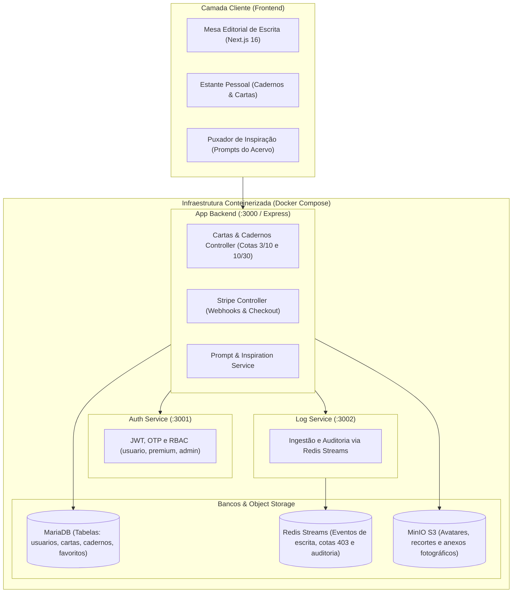

# 💌 Entre Cartas — Diário Íntimo & Correspondência Editorial

> 🎓 **Projeto Acadêmico:** Desenvolvido por **Daniel Marçal Gonçalves** para a disciplina de **Introdução à Computação em Nuvem (ISW055)** lecionada pelo professor **[@siriani](https://github.com/siriani)** (Fatec Pompeia).
>
> 📌 **Evolução Arquitetural:** Este repositório é o fork evolutivo da arquitetura anterior ([filmecc](https://github.com/danielmarcalgoncalves/filmecc)), reaproveitando integralmente os microsserviços conteinerizados em Docker, banco relacional MariaDB, object storage MinIO, mensageria com Redis Streams e pagamentos recorrentes via Stripe.

---

## 1. Nome e Proposta de Valor

**Entre Cartas** — Um santuário digital de escrita íntima, diário pessoal e correspondência solene em estética skeuomórfica editorial clássica. O usuário senta-se diante de uma escrivaninha de autor limpa para registrar suas reflexões em cadernos encadernados ou selar cartas horizontais, enquanto um acervo de correspondências históricas atua exclusivamente como motor de inspiração poética.

---

## 2. A Dor

* **Quem sofre:** Estudantes universitários, leitores, entusiastas de *journaling*, escritores e pessoas sensíveis (18 a 35 anos) sobrecarregadas pelo imediatismo, dopamina rasa e vigilância constante das redes sociais contemporâneas (feeds infinitos, métricas de vaidade e interfaces corporativas frias).
* **Quando ocorre:** Em momentos de descompressão, madrugadas reflexivas, processos de autoconhecimento, luto emocional ou no fechamento de um dia exaustivo em que o indivíduo precisa desacelerar e organizar sentimentos.
* **Quanto custa hoje:**
  * **Custo Emocional:** Ansiedade, perda da capacidade de foco sustentado e isolamento subjetivo por não expressar pensamentos autênticos.
  * **Custo Financeiro:** Gastos contínuos entre R$ 60,00 e R$ 250,00 mensais com cadernos físicos importados, tintas, canetas e papelaria artesanal para anotações que acabam esquecidas em gavetas físicas, sem busca e sem backup na nuvem.
  * **Risco Real:** Deterioração física de cadernos (mofo, extravio em mudanças) ou exposição involuntária de segredos íntimos em redes digitais abertas.
* **Como resolvem hoje (e por que falham):**
  * *Diários físicos trancados:* Garantem privacidade, mas não possuem sincronização em nuvem, não oferecem estímulos criativos quando ocorre bloqueio de escrita e deterioram com o tempo.
  * *Aplicativos corporativos (Notion, Google Docs, Apple Notes):* Telas assépticas, cinzentas e focadas em produtividade empresarial que quebram o clima afetivo e literário da escrita.
  * *Fóruns de desabafo (Reddit):* Ambientes puramente textuais, hostis e sujeitos a comentários maliciosos de estranhos.

---

## 3. Persona Concreta

* **Nome:** Clara Menezes
* **Idade:** 24 anos
* **Ocupação & Rotina:** Assistente de redação e estudante de Letras em São Paulo. Passa o dia inteiro diante de dashboards de analytics, planilhas e e-mails corporativos padronizados.
* **O que tenta fazer:** À noite, Clara quer desligar as notificações, colocar uma música ambiente suave e sentar para escrever em um diário sem pressa. Ela busca registrar como se sentiu durante o dia, redigir cartas a pessoas que marcaram sua trajetória (que talvez nunca envie) e organizar suas memórias em cadernos temáticos.
* **O que a atrapalha:** O bloqueio da página em branco quando não sabe por onde começar e o ruído invasivo dos aplicativos digitais convencionais. Quando usa cadernos de papel, teme que alguém os leia em casa ou que se percam em mudanças.

---

## 4. O Papel do Dataset: Motor de Inspiração Poética

No **Entre Cartas**, o dataset de correspondências históricas e anônimas **não é um catálogo passivo de consumo**, mas sim a **centelha criativa da escrita**:

* Ao sentar diante da folha de escrita com bloqueio criativo, o usuário aciona o botão **"Puxar Inspiração"**.
* O sistema consome o dataset para sortear um trecho epistolar expressivo acompanhado de um **Prompt Reflexivo de Escrita** (ex: *"Escreva sobre um detalhe do seu dia que ninguém além de você percebeu"*).
* A frase inspiradora selecionada é fixada na marginalia da escrivaninha como guia para a produção textual do dia.

---

## 5. Estante Pessoal: O Arquivo do Autor

A **Estante Pessoal** reúne toda a produção do usuário em um fichário elegante e ordenado:

* **Visão de Cadernos:** Alternância entre os diferentes cadernos criados pelo usuário (ex: *Diário de Memórias*, *Caderno Noturno*, *Crônicas da Janela*), exibindo o progresso de páginas redigidas.
* **Visão de Cartas:** Todas as cartas escritas, seladas e arquivadas pelo autor, organizadas por sentimento e data.
* **Filtros e Cotas em Tempo Real:** Indicador claro de uso das cotas do plano ativo com atalho para o upgrade no Clube Premium.

---

## 6. Modelo de Negócio com Stripe & Regras de Cotas (RBAC)

O sistema opera no modelo **Freemium com Assinatura Mensal Recorrente** integrada ao **Stripe Billing / Checkout** (R$ 14,90/mês):

| Recurso / Cota | Plano Normal (Gratuito — R$ 0,00) | Clube do Remetente Premium (R$ 14,90/mês) |
| :--- | :--- | :--- |
| **Limite de Cadernos** | **Até 3 cadernos** de escrita | **Até 10 cadernos** temáticos |
| **Limite de Cartas Escritas** | **Até 10 cartas** redigidas e seladas | **Até 30 cartas** redigidas e arquivadas |
| **Prompts de Inspiração** | Ilimitados (Sorteados do Acervo) | Ilimitados (Sorteados do Acervo) |
| **Pautas & Paginação Contínua** | Sim (28px matemáticos) | Sim (28px matemáticos) |
| **Papéis de Escrita** | Algodão & Marfim, Branco Clássico | Todos (Algodão, Pergaminho Suave, Linho Cru Nobre) |
| **Tintas Editoriais** | Nanquim Suave | Todas (Nanquim, Azul-Noite, Sépia de Arquivo, Grafite) |
| **Ações de Carimbo** | FAVORITAR básico | Carimbo solene **FAVORITADO ♥** |
| **Armazenamento em Nuvem** | Backup sincronizado no MariaDB | Backup ilimitado + Anexos no MinIO Object Storage |
| **Selo de Perfil** | Autor Leitor | **★ Membro de Honra Premium** |

* **Regra de Bloqueio 403 (Backend & Frontend):** Se um usuário do Plano Normal tentar criar o 4º caderno ou salvar a 11ª carta, a aplicação bloqueia a criação preventivamente, registra o evento de cota atingida no Redis Streams e oferece o fluxo do Stripe Checkout.

---

## 7. Mapeamento Arquitetural (Computação em Nuvem — ISW055)

A arquitetura de microsserviços conteinerizada atende integralmente à ementa acadêmica do Prof. Siriani:



### Detalhamento dos Componentes de Nuvem:
1. **MariaDB (Banco Relacional):**
   - Armazenamento de metadados de cadernos (`pastas_memorias`), páginas de diário e cartas escritas pelo autor (`cartas`).
   - Tabela de favoritos com carimbos solenes (`carta_favoritos`).
2. **MinIO (Object Storage S3):**
   - Bucket para fotos de perfil, texturas de papel de alta densidade e anexos fotográficos estilo Polaroid.
3. **Redis Streams (Mensageria e Auditoria):**
   - Rastreamento assíncrono de eventos: `PAGINA_SALVA`, `CADERNO_CRIADO`, `INSPIRACAO_SORTEADA`, `BLOQUEIO_LIMITE_CARTAS_403`, `STRIPE_CHECKOUT_COMPLETED`.
4. **Auth & RBAC (Segurança):**
   - Controle de acesso granular por JWT com verificação de papéis (`usuario`, `premium`, `admin`).
5. **Stripe Billing:**
   - Integração com Stripe Hosted Checkout e Customer Portal com Webhook assinado criptograficamente para upgrade instantâneo das cotas de 3 para 10 cadernos e 10 para 30 cartas.

---

## 8. Como Executar o Projeto Localmente

### Pré-requisitos
- Docker e Docker Compose instalados
- Node.js 20+ e pnpm / npm

### Passo a Passo

1. **Clonar o Repositório:**
   ```bash
   git clone https://github.com/danielmarcalgoncalves/entre-cartas.git
   cd entre-cartas
   ```

2. **Subir a Infraestrutura em Contêineres:**
   ```bash
   docker-compose up -d
   ```

3. **Executar o Frontend Next.js:**
   ```bash
   cd frontend
   pnpm install
   pnpm dev
   ```

4. **Acessar a Aplicação:**
   - **Frontend (Mesa de Escrita & Estante):** [http://localhost:3000](http://localhost:3000)
   - **API Backend:** [http://localhost:3000/api](http://localhost:3000/api)

---

## 👤 Autor & Créditos

* **Autor:** Daniel Marçal Gonçalves
* **Disciplina:** Introdução à Computação em Nuvem (ISW055)
* **Professor:** [@siriani](https://github.com/siriani) — Fatec Pompeia
