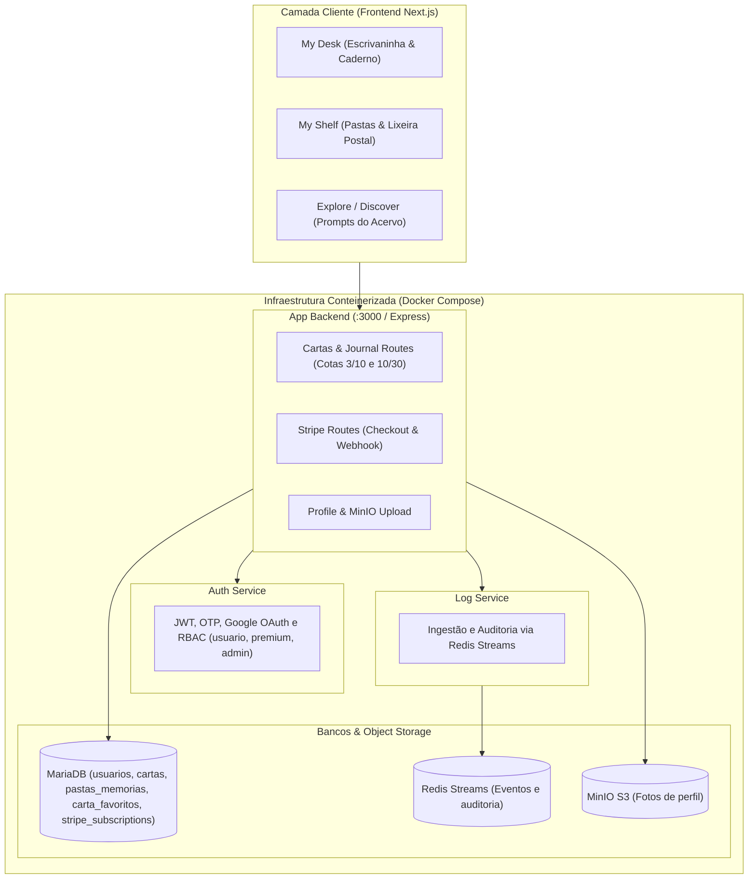

# 💌 Entre Cartas — Diário Íntimo & Correspondência Editorial

> 🎓 **Projeto Acadêmico:** Desenvolvido por **Daniel Marçal Gonçalves** para a disciplina de **Introdução à Computação em Nuvem (ISW055)** lecionada pelo professor **[@siriani](https://github.com/siriani)** ([github.com/siriani](https://github.com/siriani)) — Fatec Pompeia.
>
> 📌 **Evolução Arquitetural (Fork):** Este repositório é o fork evolutivo do sistema anterior ([filmecc](https://github.com/danielmarcalgoncalves/filmecc)), reaproveitando integralmente os microsserviços conteinerizados em Docker, banco relacional MariaDB, object storage MinIO, mensageria com Redis Streams, autenticação RBAC e pagamentos recorrentes via Stripe.

---

## 1. Nome e Frase

**Entre Cartas** — Um santuário digital de escrita íntima, diário pessoal e correspondência editorial para jovens adultos e entusiastas de *journaling* que querem organizar seus pensamentos sem o ruído das redes sociais.

---

## 2. A Dor

* **Quem sofre:** Estudantes universitários, leitores, entusiastas de *journaling*, escritores e pessoas sensíveis (18 a 35 anos) sobrecarregadas pelo imediatismo, dopamina rasa e exposição das redes sociais contemporâneas.
* **Quando ocorre:** Em momentos de descompressão, madrugadas reflexivas, processos de autoconhecimento, luto emocional ou no fechamento de um dia exaustivo em que a pessoa precisa desacelerar e organizar sentimentos.
* **Quanto custa hoje:**
  * **Custo Financeiro:** Gastos recorrentes entre **R$ 60,00 e R$ 250,00 por mês** com cadernos físicos artesanais, canetas, tintas e papelaria que acabam esquecidos em gavetas, sem busca e sem backup.
  * **Custo de Tempo:** De **20 a 40 minutos por sessão** travado diante da página em branco por falta de estímulo criativo, ou procurando anotações antigas espalhadas em vários cadernos e blocos de notas soltos.
  * **Risco Real:** Deterioração física de diários (umidade, mofo, perda em mudanças), leitura indevida por terceiros em casa ou exposição involuntária de desabafos em plataformas abertas.
* **Como resolve hoje (e por que falha):** Usando diários físicos trancados (sem backup na nuvem nem busca), aplicativos corporativos como Notion/Google Docs (frios e sem atmosfera literária) ou fóruns de desabafo como o Reddit (públicos e sujeitos a comentários hostis).

---

## 3. Persona

* **Nome:** Clara Menezes
* **Idade:** 24 anos
* **Ocupação & Rotina:** Assistente de redação e estudante de Letras. Passa o dia inteiro diante de dashboards corporativos, planilhas e e-mails padronizados.
* **O que tenta fazer:** À noite, Clara quer desligar as notificações, colocar uma música ambiente suave e sentar para escrever em seu diário sem pressa, redigir cartas que talvez nunca envie e organizar suas memórias em cadernos e pastas temáticas com backup seguro.
* **O que atrapalha:** O bloqueio da página em branco quando não sabe por onde começar, o visual frio e empresarial das ferramentas de notas comuns e o medo de perder ou ter seus cadernos físicos lidos por outras pessoas.

---

## 4. Concorrentes e Alternativas

| Concorrente / Alternativa | Como funciona hoje | O que faz mal para a persona |
| :--- | :--- | :--- |
| **Cadernos físicos de papelaria** | Diários e cadernos artesanais comprados todo mês | Custo alto (R$ 60–250/mês), não têm backup na nuvem, não permitem busca nem restauração rápida e correm risco de perda ou leitura por terceiros |
| **Notion / Google Docs / Apple Notes** | Aplicativos de produtividade e documentos em nuvem | Visual corporativo e asséptico (cara de trabalho), sem atmosfera literária, sem pastas afetivas e sem prompts de inspiração para destravar a escrita |
| **Day One / Journey** | Apps tradicionais de *journaling* | Focados em registro estilo feed/calendário técnico, sem experiência tátil de escrivaninha, cadernos encadernados e correspondência com pastas e lixeira postal |
| **Reddit / Redes sociais privadas** | Fóruns de desabafo ou contas secundárias trancadas | Exposição pública, dependência de algoritmos, anúncios e ausência de organização em volumes de cadernos e cartas seladas |

---

## 5. Proposta de Valor

Para jovens adultos que buscam desacelerar através da escrita, o **Entre Cartas** une a estética tátil de uma escrivaninha clássica com cadernos encadernados, pastas de correspondência, prompts de inspiração literária e backup seguro na nuvem — sem a frieza dos apps corporativos nem o custo recorrente da papelaria física.

---

## 6. Modelo de Receita com Stripe

O sistema opera no modelo **Freemium com Assinatura Mensal Recorrente** integrada ao **Stripe Checkout & Webhooks** (**R$ 14,90/mês**, exibido como `$14.90/month` na interface em inglês):

| Recurso / Cota | Plano Standard (Free — R$ 0,00) | Clube do Remetente Pro (R$ 14,90/mês) |
| :--- | :--- | :--- |
| **Cadernos (Journal Volumes)** | **Até 3 cadernos** | **Até 10 cadernos** |
| **Pastas de Correspondência** | **Até 3 pastas** | **Até 10 pastas** |
| **Cartas Escritas e Arquivadas** | **Até 10 cartas** | **Até 30 cartas** |
| **Prompts de Inspiração do Acervo** | Ilimitados | Ilimitados |
| **Papéis e Tintas Editoriais** | 4 papéis e 4 tintas disponíveis | 4 papéis e 4 tintas disponíveis |
| **Armazenamento & Perfil** | Sincronização MariaDB + avatar no MinIO | Sincronização MariaDB + avatar no MinIO + selo **Pro Sender Club** |

* **Por que o usuário paga o Pro:** Quem cria o hábito semanal de escrita rapidamente atinge os limites do plano gratuito (3 cadernos temáticos, 3 pastas de correspondência e 10 cartas). Em vez de pagar caro em cadernos físicos novos todo mês, assina o **Pro** por **R$ 14,90/mês** para expandir suas cotas e preservar sua biblioteca pessoal em nuvem.
* **Regra de bloqueio (HTTP 403):** Ao tentar exceder a cota do plano Free, o backend bloqueia preventivamente com `HTTP 403`, registra o evento no Redis Streams e direciona o usuário para o fluxo de assinatura do Stripe.

---

## 7. Métricas de Sucesso

| Métrica | O que mede | Meta Inicial (Trimestre 1) |
| :--- | :--- | :--- |
| **Usuários Cadastrados (MAU)** | Pessoas com conta ativa que escrevem ao menos 1 vez por mês | 300 usuários ativos |
| **Taxa de Conversão Free → Pro** | Percentual de usuários Free que assinam após atingir a cota | 5% a 8% |
| **Assinantes Pagantes (Pro)** | Total de contas com status `premium` ativo no Stripe | 20 assinantes |
| **MRR (Receita Recorrente Mensal)** | `Assinantes Pro × R$ 14,90` | R$ 298,00 / mês (cobrindo infra VPS) |
| **Retenção Mensal (D30)** | Assinantes que renovam no mês seguinte (baixo *churn*) | ≥ 80% de retenção mensal |

---

## 8. Lean Canvas

| Bloco | Definição para o Entre Cartas |
| :--- | :--- |
| **1. Problema** | 1) Bloqueio criativo diante da página em branco; 2) Custo alto e falta de backup/privacidade em cadernos físicos; 3) Apps de notas atuais (Notion, Google Docs) têm interface fria e corporativa. *Hoje resolvido com papelaria cara ou blocos de notas genéricos.* |
| **2. Segmentos de Clientes** | Estudantes universitários, leitores, escritores iniciantes e praticantes de *journaling* (18–35 anos). *Early adopters:* universitários de Humanas/Letras e comunidades de papelaria/leitura. |
| **3. Proposta Única de Valor** | Escreva diários e cartas com a atmosfera calma de uma escrivaninha clássica, prompts de inspiração e backup seguro na nuvem — por menos que um caderno físico por mês. |
| **4. Solução** | 1) Escrivaninha interativa com cadernos pautados (3 capas temáticas) e editor de cartas; 2) Motor de inspiração epistolar para destravar a escrita; 3) Estante pessoal com pastas físicas, lixeira postal recuperável e sincronização em nuvem. |
| **5. Canais** | Comunidades literárias (BookTok, Instagram, clubes de leitura), indicação boca a boca entre universitários, conteúdos sobre *journaling* e divulgação no portfólio acadêmico. |
| **6. Fontes de Receita** | Assinatura mensal via Stripe (**Clube do Remetente Pro — R$ 14,90/mês**) após atingir as cotas gratuitas (3 cadernos, 3 pastas, 10 cartas). |
| **7. Estrutura de Custos** | Servidor VPS/Docker (hospedagem da stack), domínio, taxas de processamento do Stripe (~3,99% + R$ 0,39 por transação), envio transacional de e-mails (Brevo) e tempo de manutenção. |
| **8. Métricas-Chave** | Cadastros confirmados, cartas/páginas salvas por semana, bloqueios de cota (`403`), taxa de conversão Free → Pro, assinantes ativos, **MRR** e retenção mensal. |
| **9. Vantagem Injusta** | Identidade estética autoral em CSS puro (escrivaninha, cadernos em couro, pastas 3D e lixeira postal dinâmica) combinada a uma arquitetura completa já pronta em microsserviços com acervo curado de inspiração. |

---

## 9. Mapa de Reaproveitamento da Arquitetura

| Peça do projeto atual (`filmecc`) | O que vira no SaaS | Papel no **Entre Cartas** |
| :--- | :--- | :--- |
| **Catálogo de filmes (TMDB)** | Recurso principal do negócio | **Cartas, cadernos e pastas** (`/api/cartas`, `/api/journal`): acervo epistolar de inspiração + criação de cartas e páginas de diário do usuário |
| **Microsserviço de login + RBAC** | Papéis do negócio | `usuario` (Plano Free: 3 cadernos, 3 pastas, 10 cartas), `premium` (Plano Pro: 10 cadernos, 10 pastas, 30 cartas) e `admin` (auditoria), com OTP e Google OAuth |
| **Logs e auditoria (Redis)** | Eventos de negócio | Eventos no Redis Streams via `log-service`: criação de carta/caderno, sorteio de inspiração, bloqueio de cota `403`, login e webhook Stripe (`/api/admin/logs`) |
| **Upload e perfil (MinIO)** | Arquivos do domínio | Bucket `perfil-fotos` no MinIO para upload de foto de perfil do autor (`/api/profile`) |
| **Plano Premium (Stripe)** | Assinatura recorrente | **Clube do Remetente Pro (R$ 14,90/mês)** via Stripe Checkout + Webhook idempotente (`stripe_subscriptions` e `stripe_webhook_events`) liberando cotas expandidas |
| **Docker Compose, Portainer & Extras** | Infraestrutura e observabilidade | Mesma stack conteinerizada (`app`, `auth-service`, `log-service`, `mariadb`, `redis`, `minio`), endpoint `/api/health` e documentação técnica |

---

## 10. Arquitetura Técnica e Detalhes do Sistema



### Como Executar o Projeto Localmente

1. **Clonar o Repositório:**
   ```bash
   git clone https://github.com/danielmarcalgoncalves/entre-cartas.git
   cd entre-cartas
   ```
2. **Subir a Infraestrutura em Contêineres:**
   ```bash
   docker compose up -d --build
   ```
3. **Acessar a Aplicação:**
   - **Aplicação (Frontend + API):** [http://localhost:3000](http://localhost:3000)
   - **Healthcheck da API:** [http://localhost:3000/api/health](http://localhost:3000/api/health)

---

## 👤 Autor & Créditos

* **Autor:** Daniel Marçal Gonçalves
* **Disciplina:** Introdução à Computação em Nuvem (ISW055)
* **Professor:** [@siriani](https://github.com/siriani) — Fatec Pompeia
